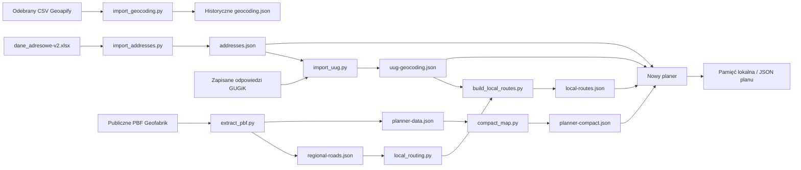

# Architektura i kontrakty MMS Planowanie 2.0

Stan: 17.11.2026. Repozytorium zawiera eksperyment MAP-04, starszy demonstrator MAP-05 i nowy planer na liście użytkownika. Są to oddzielne warstwy. Nie zastępować starszego fixture rzeczywistymi danymi.

## Stos i granice aplikacji

Frontend to zwykłe moduły JavaScript, HTML, CSS i SVG. Nie ma Reacta, TypeScript, bundlera ani konfiguracji lint. Python służy do odczytu danych, lokalnego grafu dróg, budowania pojedynczych plików HTML i opcjonalnego serwera statycznego. Produkcyjna aplikacja nie wymaga bibliotek Python. `openpyxl==3.1.5` jest potrzebne do importu XLSX i jego testów. `happy-dom==21.0.3` jest wyłącznie zależnością testową; nie trafia do aplikacji.

`map05/planner-offline.html` jest aktualnym samowystarczalnym artefaktem. Osadza katalog, geokodowanie, regionalny podkład, lokalne wyniki dróg, CSS i kod. CSP ma `connect-src 'none'`; używanie nie wysyła danych. `map05/offline.html` jest starszym widokiem 19 syntetycznych zleceń. Nie pomylić obu plików.

`map05/serve.py` to opcjonalny serwer tylko na `127.0.0.1`. Domyślne `/` pokazuje `planner.html`, `/index.html` stary widok. Handler ma ścisłą listę plików i obsługuje GET/HEAD; nie udostępnia źródłowych XLSX, manifestów geokodowania, surowych odpowiedzi, grafu wejściowego, PBF, `.env` ani kodu Pythona. Nie ma API zapisującego dane lub wywołującego routing.

## Przepływ danych



Zewnętrzne geokodowanie było oddzielną, jednorazowo zatwierdzoną operacją przygotowania danych. Nie jest częścią tego przepływu podczas działania aplikacji. Zewnętrzny routing został odrzucony i nie został wykonany.

## Mapa plików

| Plik / katalog | Odpowiedzialność |
| --- | --- |
| `map04/fixtures.json` | Niezmieniony, syntetyczny fixture 5 ekip / 19 zleceń OPO i KNU. |
| `map04/rules.py` | Referencyjne funkcje reguł 30 km, wspólnego +10 km, okna, ciągłości i zasobów. Przyjmują wartości wejściowe; nie wyznaczają dróg. |
| `map04/routing.py` | Kontrakt adaptera i deterministyczny adapter syntetycznego fixture; nie jest usługą rzeczywistych dróg. |
| `map05/model.mjs`, `app.mjs`, `index.html`, `styles.css` | Starszy demonstrator. |
| `map05/planner-model.mjs` | Nowy scenariusz, kolejka, walidacja zasobów, transakcje przydziałów, generator i zapis v1. |
| `map05/locations.mjs` | Walidacja i połączenie geokodowania; rozróżnienie lokalizacji używalnych i kandydatów. |
| `map05/routes.mjs` | Walidacja lokalnego snapshotu dróg, dekoder geometrii, ocena całego koszyka. |
| `map05/map.mjs` | Wspólne rzutowanie Web Mercator i geometria SVG; nie wyznacza tras. |
| `map05/operational-map.mjs` | MAP-06: czysta projekcja `(scenario, plan, dzień, opcje widoku)` → GeoJSON wizyt/tras/kolejki + lista braków. Nie przechowuje przydziałów. |
| `map05/road-tiles.mjs` | MAP-06: lokalne kafle wektorowe MVT generowane w przeglądarce z `planner-compact.json` (protokół `mmsroads://`). |
| `map05/maplibre-view.mjs` | MAP-06: adapter MapLibre GL (warstwy, kontrolki, popup, podkład drogowa/satelita/hybryda). Edycje deleguje do planera. |
| `map05/road-tile-worker.mjs` | MAP-06.1: usługa kafli w Web Workerze (`init`/`tile`/`cancel`); sama rozpakowuje i parsuje podkład, buduje indeks i koduje MVT; kolejka LIFO, jeden kafel na zadanie. |
| `map05/road-tile-client.mjs` | MAP-06.1: klient w wątku głównym (`tile(z,x,y,signal)`, `ready`, `failed`, `destroy`); wariant workerowy i inline (gdy brak Workera). Awaria workera jest terminalna i sygnalizowana planerowi. |
| `map05/embedded-data.mjs` | MAP-06.1: dekoder osadzonych bloków (`json`, `gzip-base64` przez `DecompressionStream`). |
| `map05/vendor/maplibre-gl/` | MapLibre GL JS 6.19.0 (BSD-3), niemodyfikowany, z manifestem SHA256 i notami stron trzecich. |
| `map05/planner-map.mjs` | Przygotowanie regionalnego podkładu, filtrowanie widoku, poziom szczegółu i leniwe dekodowanie ulic. Klasa drogi zależy od zbliżenia. Powyżej limitu (domyślnie 1 600 ścieżek) pomijane są odcinki krótsze niż ~1 px ekranu, a pozostałe sortowane są według klasy i długości. Etykiety i skala w SVG muszą mieć `vector-effect:non-scaling-stroke`, bo viewBox skaluje obwódki. |
| `map05/planner.mjs` | Powiązanie kontrolek, kolejki, koszyków, szczegółów, dostępności, mapy, historii sesji i importu/eksportu. |
| `map05/planner.html`, `planner.css` | Struktura i wygląd nowego interfejsu. |
| `map05/data/import_addresses.py` | Odczyt XLSX, normalizacja i zachowanie wierszy źródłowych/duplikatów. |
| `map05/data/import_geocoding.py` | Lokalny import odebranego CSV Geoapify; bez nowych wywołań. |
| `map05/data/fetch_uug.py` | Ręczne, zatwierdzone pobieranie GUGiK; domyślnie tylko walidacja manifestu. |
| `map05/data/import_uug.py` | Lokalna ocena odpowiedzi GUGiK i raport porównawczy. |
| `map05/basemap/download_osm.py` | Historyczne pobranie małych wycinków OPO/KNU do starego widoku. |
| `map05/basemap/download_regional.py` | Przetwornik danych Overpass i zapis nieudanej metody pobrania; nie uruchamiany przez aplikację. |
| `map05/basemap/download_pbf.py` | Jawne pobranie stałych publicznych plików województw z kontrolą MD5/SHA256. |
| `map05/basemap/osm_pbf.py` | Strumieniowy dekoder OSM PBF bez dodatkowych zależności. |
| `map05/basemap/extract_pbf.py` | Dwa przebiegi po publicznych PBF, filtrowanie do ustalonego obszaru, zachowanie topologii i ograniczeń. |
| `map05/basemap/compact_map.py` | Słowniki nazw/klas i kodowanie geometrii podkładu, bez zmiany grafu routingu. |
| `map05/local_routing.py` | Lokalny skierowany graf samochodowy i najkrótsze ścieżki z pamięcią podejścia do skrzyżowania. |
| `map05/build_local_routes.py` | Wszystkie pary znanych punktów, współdzielone geometrie, checkpointy wierszy, raport pokrycia. |
| `map05/pack_public_assets.py`, `prepare_assets.py` | Bezstratne archiwizowanie/odtwarzanie dużych publicznych wejść, bez pobierania i bez nadpisywania zmienionych plików. |
| `map05/build_offline.py`, `build_planner.py` | Odtwarzalne artefakty z hashami CSP. |
| `map05/tests/`, `map04/tests/` | Testy danych, parserów, reguł, grafu, UI w pamięci i dostarczania. |

## Katalog adresów i lokalizacje

`addresses.json` ma `schemaVersion:1`, `source` z nazwą arkusza/zakresem i SHA256 XLSX, `quality` oraz `addresses`. Adres przechowuje stabilne ID, miejscowość, ulicę, numer budynku, lokal, kod, etykietę i wiersze źródłowe. Katalog sam nie ma potwierdzonych współrzędnych ani regionu. Współrzędne nie są dopisywane do XLSX.

`datasetId` jest SHA256 oryginalnego XLSX. Nie zmienia się po dodaniu warstwy geokodowania lub dróg. Zlecenia mają stabilne `TEST-001`…`TEST-109`; nie zmieniać ich kolejności bez migracji. To chroni plany zapisane w poprzednich etapach.

Warstwa geokodowania ma pełne mapowanie `addressId`, pochodzenie, kandydata, powody i status. Obca/niepełna/powtórzona tożsamość jest błędem całego importu. Nie łączy się wyników według numeru wiersza odpowiedzi.

Obsługiwane statusy:

- `MATCHED_BUILDING`: punkt dopasowany według warunków danego dostawcy.
- `MATCHED_BUILDING_POSTCODE_NOTE`: tylko GUGiK; jeden zwrócony kandydat, zgodny pełny numer, miejscowość, ulica i rejestry, różny poprawny kod z tym samym dwucyfrowym prefiksem. Oba kody zachowane; na mapie przerywany obrys.
- `REVIEW_REQUIRED`: odpowiedź nie daje jednoznacznej lokalizacji; współrzędne kandydata nie są markerem.
- `MISSING_COORDINATES`: brak warstwy lub wyniku lokalizacji.

Geoapify ma progi confidence ≥0,95 dla wymaganych pól. GUGiK nie używa tych progów: porównuje pełny numer z literą, miejscowość/część, kod, ulicę i TERYT/SIMC/ULIC. Rozwinięta nazwa ulicy może być potwierdzona przez dokładne `street_part_accuracy` i ULIC. Nie ma niejawnego słownika aliasów zmieniającego źródłowy adres.

## Scenariusz i lokalny plan

`createScenario(dataset, geocoding=null, routes=null)` tworzy scenariusz. Typy MPL/MPL/BSA/POMIAR, gotowość i wiek są deterministycznie syntetyczne. Testowe czasy bazowe to MPL 120 min, BSA 150 min, pomiar 45 min; wariant dwóch slotów mnoży je przez 2.

Plan v1 przechowuje wyłącznie:

```json
{
  "schemaVersion": 1,
  "datasetId": "sha256-arkusza",
  "availability": [{"teamId":"TEST-02","date":"2026-11-18","slots":[0,1,2]}],
  "assignments": [{"orderId":"TEST-005","teamId":"TEST-02","date":"2026-11-18","start":0,"origin":"MANUAL","confirmed":false}],
  "manualExclusions": [{"orderId":"TEST-009","date":"2026-11-18"}]
}
```

Przydział może dodatkowo mieć `releaseReason`. Nie zapisuje katalogu adresów ani wyników dróg. `restorePlan` stosuje whitelistę pól, limity rozmiaru i walidację zasobów. Nie wykonuje kodu ani HTML z pliku.

`applyAction` kopiuje plan i zwraca nowy stan dopiero po walidacji. Obsługuje `AVAILABILITY`, `ASSIGN`, `REMOVE`, `ALLOW_AUTO`, `CONFIRM`, `UNCONFIRM`, `GENERATE`. Konflikt nie usuwa części starego planu. UI przechowuje do 50 stanów cofania sesji. Zapis automatyczny ma klucz `mms-map05-plan-v1-<datasetId>`; przy niedostępnej pamięci użytkownik może eksportować JSON.

Nie ma synchronizacji kilku kart. Nie otwierać dwóch aktywnych edytorów tego samego planu z oczekiwaniem automatycznego scalania.

## Generator i ręczne korekty

Generator działa dla dnia i widocznego zakresu miejscowości/typu/wyszukiwania. Usuwa z tego zakresu jedynie wcześniejsze automatyczne, niepotwierdzone propozycje. Zachowuje inne dni, ręczne zmiany, potwierdzenia i wykluczenia. Najpierw stosuje gotowość, kwalifikacje, rzeczywistą dostępność, zajętość oraz sąsiednie sloty. Preferuje tę samą miejscowość i krótszy znany dojazd do ostatniej propozycji ekipy; to heurystyka, nie globalny optymalizator.

Jeżeli jest warstwa dróg, znane przekroczenia 30 km, +10 km lub okna blokują nowy automatyczny i ręczny przydział. Automat pozostawia nieustalone lokalizacje, niepewne przyciągnięcie do drogi i brakujące odcinki w kolejce z przyczyną. Pomiar poza instalacjami nie jest automatycznie uznawany za mieszczący się w +10 km bez znanego startu/końca.

Ręczna propozycja z niepełnymi danymi pozostaje jawną propozycją zasobową z nieocenionymi aspektami; nie staje się dowodem wykonalności. Import starych planów nie odrzuca ich wyłącznie z powodu nowo wykrytego ryzyka drogowego. Zachowuje je i pokazuje wynik oceny. To celowe rozdzielenie walidacji zapisanego planu od dopuszczania nowej propozycji.

Przeniesienie, usunięcie i regeneracja kontrolują także koszyk źródłowy. Usunięcie środkowej wizyty może zmienić łańcuch dwóch odcinków po 20 km w jeden odcinek 40 km. Cała transakcja jest odrzucana, jeżeli tworzy lub zwiększa znane naruszenie w którymkolwiek dotkniętym koszyku. Ocena porównuje klucze łańcuchów, okien i wspólnego limitu pomiarów oraz wielkość przekroczenia. Umożliwia to naprawianie starszych planów już zawierających ryzyka, bez nadpisywania ich przy odczycie.

## Lokalny graf dróg

Publiczny prostokąt wejściowy: `[17.2,49.9,19.0,51.5]` w kolejności west/south/east/north. Pobranie plików województw nie ujawnia punktów zleceń. Wybrano Opolskie, Śląskie, Dolnośląskie i Wielkopolskie. Strumieniowy PBF odtwarza delta/zigzag, DenseNodes, zwykłe węzły, odwołania dróg i członków relacji. Pierwszy przebieg wybiera drogi/relacje i potrzebne ID; drugi tylko potrzebne węzły. Do grafu trafiają pełne drogi z kompletem węzłów we wskazanym obszarze. Brakujących fragmentów nie skleja się prostą linią.

Po deduplikacji źródło ma 322 452 drogi, 2 007 799 węzłów, 18 277 węzłów sterujących i 6 081 relacji. Z tego profil samochodowy zachowuje 214 474 drogi i 690 931 skierowanych odcinków. 482 nieobsługiwane relacje powodują konserwatywne wyłączenie 473 dróg. Szczegóły i hashe są w `local-routes.json` oraz raporcie.

Najważniejsze właściwości:

- Połączenie istnieje wyłącznie przez wspólny ID węzła OSM. Geometryczne przecięcie bez wspólnego ID nie łączy mostu z drogą poniżej.
- Hierarchia dostępu: `motorcar → motor_vehicle → vehicle → access`, z wariantami kierunku. `private`, `destination`, `delivery`, `permit`, `customers` nie są domyślnie dopuszczonym tranzytem; są konserwatywnie wyłączane.
- Kierunek respektuje `oneway`, odwrócenie `-1`, jawne `no`, warianty samochodowe i domyślne rondo/motorway. Reversible/alternating i nierozpoznane warunki nie są zgadywane.
- Bariera nie znika przy kompresji grafu. Przejazd przez nieznaną/zamkniętą bramę lub słupek nie jest automatycznie dopuszczany.
- Wspierane zakazy `no_*` i nakazy `only_*` są zależne od nadjeżdżającej drogi. `no_u_turn` nie blokuje zwykłej jazdy na wprost tą samą drogą. Uwzględnia się wyjątek dla samochodów.
- Stan wyszukiwania jest skierowaną krawędzią wejściową; sam ID węzła nie wystarcza dla skrętów. Relacje via-way, warunkowe i nierozpoznane powodują wyłączenie dotkniętych dróg, a nie ciche pominięcie.
- Geometria jest kompresowana między skrzyżowaniami, kontrolami i punktami przyciągnięcia. Długość sumuje oryginalny łańcuch węzłów, nie prostą między końcami.
- Punkt budynku przyciągany jest do odcinka przejezdnej drogi, nie tylko odległego wierzchołka. Nie przyciąga się go bezpośrednio do motorway/trunk. Limit przyciągnięcia wynosi 150 m; budynek na mapie nie jest przesuwany.

Profil wybiera najkrótszą długość drogi w dopuszczonym lokalnym grafie. Czas jest odrębnym szacunkiem. Prędkości bazowe km/h: motorway 90, trunk 70, primary 60, secondary 50, tertiary 45, residential 25, unclassified 35, living_street 10, service 15; łącznice mają niższe wartości z `SPEEDS`. Rozpoznany numeryczny maxspeed ogranicza szacunek współczynnikiem 0,7, przy dolnej granicy modelu 5 km/h. Nie ma ruchu drogowego, prognozy korków ani zatwierdzonych czasów pracy.

Silnik nie jest pełnym silnikiem nawigacyjnym. Nie potwierdza wymiarów/masy konkretnego pojazdu, prawa wjazdu na posesję, manewru na granicy wizyt czy aktualnego stanu drogi. Sanitizer nie zachowuje wszystkich tagów fizycznych; wariant `restriction:vehicle` bez ogólnej reguły staje się nierozpoznaną relacją i konserwatywnym wyłączeniem, nie pełną interpretacją. Rozbudowa profilu wymaga osobnych testów i nowego snapshotu.

## Snapshot tras

`build_local_routes.py` wykonuje 102 lokalne wyszukiwania od źródła do pozostałych punktów. Nie wysyła 10 tysięcy zapytań. Każdy ukończony wiersz jest checkpointem z fingerprintem grafu, silnika, buildera i pozycji. Zmiana któregoś wejścia unieważnia cache. Kompletny plik finalny pojawia się dopiero po rozliczeniu całej partii.

`local-routes.json` ma `schemaVersion:1`, `datasetId`, pochodzenie/hash grafu i silnika, jawne założenia, `points`, `segments`, `routes` i podsumowanie. Geometrie odcinków są zapisane raz jako polyline5. Komórka trasy ma status, metry, szacowane sekundy i listę skierowanych ID geometrii; znak minus odwraca kierunek. Nieznany wynik ma `null`, nigdy fikcyjne `0`. Dystans/czas zaokrągla się w górę do 0,001 jednostki, aby nie przepuścić przekroczonej granicy przez obcięcie.

W bieżącym profilu 101/102 punktów ma przyciągnięcie w limicie. Dla 99 punktów istnieją połączenia wzajemne; dwa punkty Ostrowiny są odłączone od pozostałej sieci w tym konserwatywnym grafie. Rzędowice/Wolna 1 ma najbliższy dopuszczony odcinek około 228,63 m od punktu, poza progiem 150 m. Dostępnych jest 9 702 z 10 302 skierowanych par między różnymi punktami. Brak połączenia jest ograniczeniem grafu/profilu, nie unieważnieniem adresu.

## Ocena koszyka

`assessBasket` porządkuje wizyty według slotu, bierze skierowane odcinki i zwraca drogę/czas między wizytami, łańcuchy między instalacjami, wspólną różnicę pomiarów, ocenę poszczególnych okien i listę znanych naruszeń. `PASS` oznacza wyłącznie daną roboczą regułę w tym modelu.

Wynik +10 km pozostaje nieoceniony przy pomiarze przed pierwszą/po ostatniej instalacji bez znanych punktów startu/końca. Pierwszy dojazd ekipy także pozostaje nieustalony. Nie dopisuje się powrotu. UI pokazuje te braki zamiast agregować je do fałszywego stwierdzenia „trasa wykonalna”.

## Regionalna mapa

Podkład zawiera wszystkie 322 452 źródłowe drogi. Kompaktowy plik ma słowniki 16 klas i 7 894 nazw oraz tuple `[id,categoryIndex,nameIndex,encodedPolyline,bounds]`. Zajmuje około 28,7 MB zamiast 83,5 MB. Graf routingu nie jest przez to upraszczany.

SVG pokazuje tylko geometrię przecinającą viewport, z poziomem szczegółu zależnym od skali i limitem elementów. Odcinki dekodowane są leniwie. Wybór jednego adresu dopasowuje do skali ulic, a nie do całego regionu. Ścieżki mają dokładniejszą reprezentację niż w starym widoku, aby nie zlewać metrowych odcinków przy przybliżeniu. Miejscowości i nazwy ulic są tekstem bez wykonywalnego HTML; etykiety są odsiewane, aby ograniczyć nakładanie.

„Mapa” przy koszyku pokazuje tylko jego wizyty i znane, rzeczywiste odcinki zapisanej drogi. Brakujące odcinki nie są dorysowywane prostą. Dopasowanie uwzględnia także geometrię objazdu. „Cały zakres” wraca do filtrów kolejki. Mapa, kolejka, koszyki i szczegóły mają wspólny wybór.

## Dostarczanie i odtwarzanie

Duże publiczne wejścia `regional-roads.json` i `planner-data.json` są przechowywane w repo jako bezstratne `.json.gz`, z manifestem rozmiarów i hashy. `prepare_assets.py` odtwarza dokładne bajty lokalnie i nie nadpisuje zmienionego pliku. Publiczne PBF oraz cache wierszy nie są częścią historii Git; pozostają odtwarzalnymi plikami roboczymi. Dane potrzebne do używania aplikacji i komplet źródeł do jej dalszego rozwoju są w repo.

Hashe XLSX, CSV i MAP-04 są stałymi kontrolami niezmienności źródeł. `.gitattributes` wyłącza normalizację bajtów tych plików; JavaScript/Python/HTML mają LF. To istotne dla fingerprintu silnika i CSP. Nie uruchamiać formatowania wielomegabajtowych snapshotów jako refaktoru.

## Kafle dróg w Web Workerze i spakowane dane (MAP-06.1)

- Bloki `basemap-data` i `routing-data` w `planner-offline.html` są `type="text/plain"` z `data-encoding="gzip-base64"` (gzip 9, `mtime=0`, odtwarzalnie); serwerowy `planner.html` nadal czyta zwykłe JSON-y. Hasze CSP obejmują wszystkie bloki inline, w tym kod workera kafli i teksty licencji.
- `mapDeferred` (WebGL + Worker): wątek główny nie wczytuje podkładu dróg; podkład dostaje worker (tekst osadzony lub URL). Mapa SVG i jej dane są ładowane dopiero przy przejściu awaryjnym (`ensureSvgMap`).
- Protokół `mmsroads://z/x/y` w wątku głównym tylko przekazuje żądanie do klienta kafli i obsługuje `AbortSignal`; kafel wraca jako `ArrayBuffer` (transfer).
- Każda awaria (start workera, awaria po starcie, nieczytelna wiadomość, brak API) kończy się przejściem na SVG z komunikatem; dane planu i przydziały nie są dotykane.
